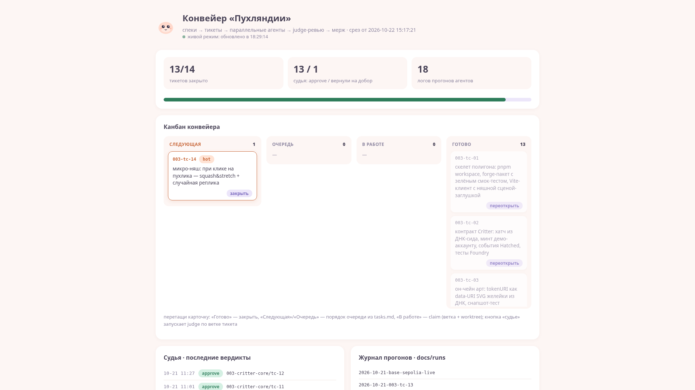

# agent-factory

> Конвейер агентной разработки: спека → тикеты → параллельные CLI-агенты →
> judge-ревью диффа → мерж. Продуктовый полигон конвейера — **web3-игра
> «Пухляндия»**: милые существа, живущие в блокчейне.

<p align="center">
  <br>
  <em>Игра «Пухляндия» — продуктовый полигон конвейера (Base Sepolia)</em><br><br>
  <br>
  <em>Живой дашборд конвейера — <code>pnpm dashboard</code>: канбан тикетов, метрики, запуск judge с экрана</em>
</p>

Продукт здесь — не цель, а полигон. Цель — показать и отработать
**производственный сетап агентной разработки**: как инженер декомпозирует
спеку на короткие проверяемые тикеты, раздаёт их параллельным CLI-агентам
(Claude Code / Codex / opencode), и как результат проверяется тестами и
моделью-судьёй до мержа.

## Живой результат конвейера

Пухлик №1 задеплоен в демо-сети **Base Sepolia** (chain 84532) — это
не макет: каждая кнопка заботы в UI отправляет настоящую транзакцию,
арт существа рисуется контрактом прямо в `tokenURI`.

| Контракт | Адрес |
|---|---|
| Critter (ERC-721, ДНК + эволюция) | [`0xf9cC9371d6392de66Cb1BA4Caef1e90F9d3A6b1A`](https://sepolia.basescan.org/address/0xf9cC9371d6392de66Cb1BA4Caef1e90F9d3A6b1A) |
| ERC-6551 Registry | [`0x5d8Cdad3D38E7921720F74018B7eBfbf788aFDcb`](https://sepolia.basescan.org/address/0x5d8Cdad3D38E7921720F74018B7eBfbf788aFDcb) |
| Token Bound Account пухлика | [`0xf44B34bf267fD2735fD31F3F1A9a100d57a0A596`](https://sepolia.basescan.org/address/0xf44B34bf267fD2735fD31F3F1A9a100d57a0A596) |
| Achievements (ачивки в кошелёк питомца) | [`0x8Af3ef94e6D2881e1ADFDE6c7eb0b4fEA416D2CB`](https://sepolia.basescan.org/address/0x8Af3ef94e6D2881e1ADFDE6c7eb0b4fEA416D2CB) |

## Конвейер в цифрах

- **13 из 14 тикетов** спеки `003-critter-core` прошли полный цикл:
  claim → worktree → агент → тесты → judge → мерж;
- **14 отчётов judge** в `judge/results/`, включая живую историю
  request-changes → добор → approve (дифф [tc-06] был завёрнут судьёй
  по 5 замечаниям и пересдан) — gate не фикция;
- **19 логов прогонов** в `docs/runs/`: план, итерации, падения тестов,
  затраты времени агента — «прогон задачи» читается глазами от спеки
  до результата;
- он-чейн деплой и золотой путь сцены проверены вживую
  (см. `docs/runs/2026-10-21-base-sepolia-live.md`).

## Как устроено

```
├── AGENTS.md            # правила для агентов — единый вход
├── openspec/            # спеки: proposal → spec-delta → tasks.md
│   └── changes/<фича>/  #   фича = набор мелких верифицируемых тикетов
├── orchestrator/        # очередь тикетов + диспетчер параллельных агентов
├── worktrees/           # git worktree на агента (изоляция прогонов)
├── judge/               # gate перед мержем: judge-LLM ревьюит дифф против спеки
├── dashboard/           # метрики конвейера: очередь, закрытые тикеты
├── packages/            # слой продукта: contracts (Foundry) + web (Vite/React)
└── docs/                # ТЗ, журнал прогонов, деплой-процедуры
```

Словарь агентной разработки → артефакты репозитория:

| Понятие | Что здесь |
|---|---|
| specs | `openspec/changes/*/proposal.md` + `tasks.md`: тикет = короткая проверяемая задача |
| loops | прогон тикета агентом: план → код → тест → повтор по логам падения → сдача |
| оркестрация | `orchestrator/`: очередь тикетов, несколько агентов в worktrees, мерж по готовности |
| прогон задачи | лог одной задачи от спеки до мержа: что агент уточнял, что judge отклонил, что правилось руками |
| judge перед мержем | `judge/`: модель-судья **другого вендора**, чем кодящий агент, ревьюит дифф против спеки; вердикт approve / request-changes |
| метрики | тикетов/день, доля first-pass через judge, время прогона; `node orchestrator/index.mjs snapshot` |

## Быстрый старт

Нужны: Node 20+, pnpm, [Foundry](https://book.getfoundry.sh/) (forge/anvil/cast).

```bash
pnpm install --frozen-lockfile

# контрактный слой (юнит-тесты идут на локальном anvil, без сети)
cd packages/contracts && forge test

# клиентский слой
pnpm -r test          # vitest (сеть из тестов не трогается — моки viem)
pnpm --filter web dev # сцена на http://localhost:5173
```

Без `.env` сцена показывает милый экран «ждём-ждем деплоя» — софт деградирует
нежно, не падает. Шаблоны: `.env.example` (judge/деплой),
`packages/web/.env.example` (адреса контрактов, burner-ключ).

## Judge-gate

Дифф каждого тикета перед мержем ревьюит модель-судья другого вендора
(конфиг `JUDGE_*` в `.env`, OpenAI-совместимый API):

```bash
set -a; source .env; set +a
node judge/index.mjs --branch work/<NNN>/<slug>
```

Судья проверяет соответствие спеке, отсутствие галлюцинаций API,
покрытие тестами и (для UI) доктрину продукта: «работает, но скучно»
= request-changes. Отчёты с вердиктами — в `judge/results/`.

## Деплой игры

Пошаговая процедура (кран → сухой прогон на anvil → деплой на Base
Sepolia → верификация → проводка адресов в web) — в
[docs/deploy-steps.md](docs/deploy-steps.md), включая проверенный путь
финансирования тестнета без реальных средств.

## Статус

- [x] Полигон №1 (коррелятор новостей/цен, спеки 001–002) отработан
      конвейером и удалён — остался в истории git как референс.
- [x] Полигон №2 — игра «Пухляндия»: скелет, 13/14 тикетов спеки
      003-critter-core закрыты через judge, деплой на Base Sepolia.
- [ ] tc-14 (микро-няш: squash&stretch) — закрыт вживую, как демо
      полного цикла конвейера.
- [ ] v2-спека: автономный AI-агент питомца (LLM решает следующий уход,
      ходы поверх ERC-6551 кошелька).

## Принципы

- Конвейер важнее продукта. Фича игры ценна в первую очередь тем, что
  даёт пачку тикетов для конвейера.
- Каждый тикет — короткий и проверяемый: код + тест (Foundry для
  контрактов, vitest для TS), а не «сделай модуль».
- Няшность — функциональное требование продукта, а не вкусовщина:
  judge отклоняет «скучный» UI как регрессию (доктрина в AGENTS.md).
- Никакого вайб-кода руками поверх агентов: ручной фоллэк отдельно и явно.
- Все секреты — в `.env` (`.env.example` обязателен), в репо не попадают.
